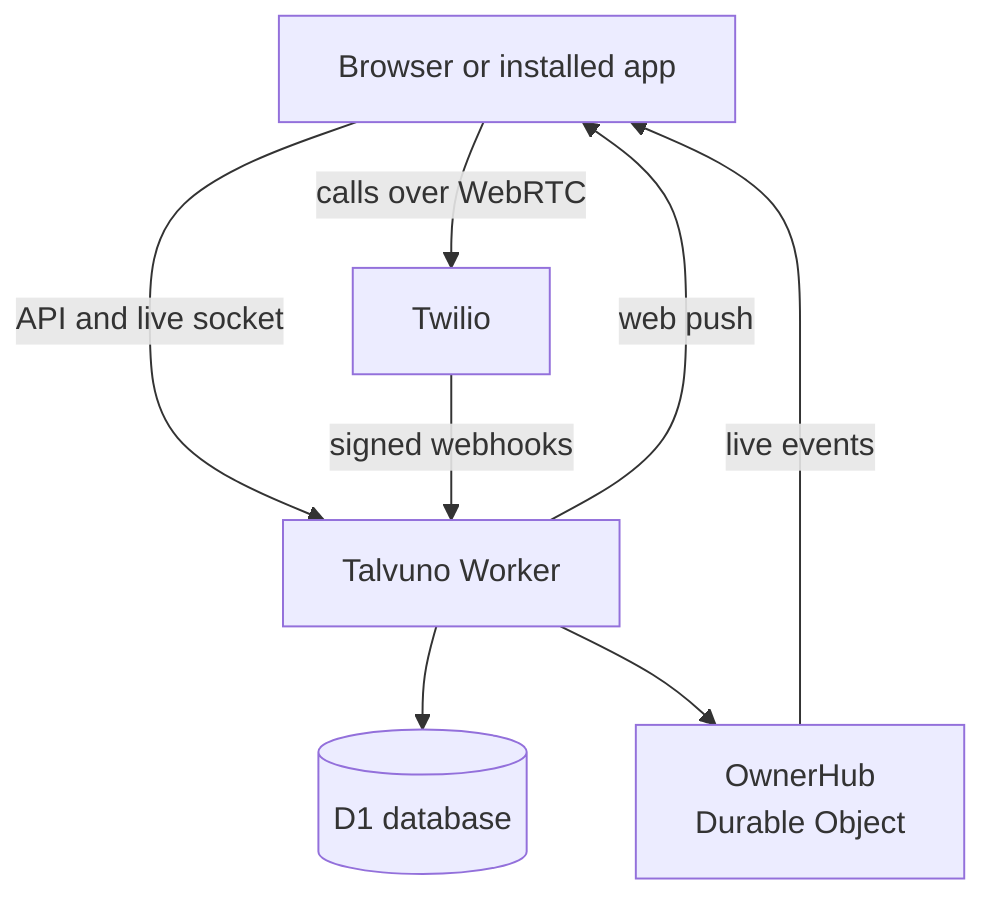

<p align="center">
  <picture>
    <source media="(prefers-color-scheme: dark)" srcset="docs/assets/talvuno-logo-horizontal.png">
    
  </picture>
</p>

<p align="center">
  A self-hosted softphone and two-way SMS app for your Twilio numbers, running on one Cloudflare Worker.
</p>

<p align="center">
  <a href="https://docs.talvuno.h1n054ur.dev/">Documentation</a> ·
  <a href="https://docs.talvuno.h1n054ur.dev/getting-started/">Getting started</a> ·
  <a href="LICENSE">MIT licence</a>
</p>

Talvuno lets you make and take calls and send texts from a browser or an installed web app, using phone numbers you already have on Twilio. You deploy it to your own Cloudflare account, so the call history, messages and contacts stay in your own database. Twilio keeps its own logs of calls and messages as usual. Call audio goes straight between the browser and Twilio and never passes through the Worker.

<p align="center">
  
  
</p>

## What it does

- Calls from the browser to any phone, with mute, a keypad for menus and a choice of caller ID
- Incoming calls ring in the app while it is open, on a phone or a desktop
- Two-way SMS with threads, delivery status, unread counts and search
- Contacts with vCard import and export, matched to callers and threads
- Call history built from Twilio's own status callbacks, so it matches your Twilio log
- Several Twilio numbers, a default caller ID and a per-number inbox filter
- Live updates on every open screen, and push notices for missed calls and new texts when the app is closed
- One owner account, with optional single sign-on through any OpenID Connect provider
- A country allowlist and hourly limits for calls and texts, checked on the server
- Signed Twilio webhooks, a Content Security Policy with per-request nonces and installable PWA support

## Screens

<details>
<summary>Sign in</summary>

<p>
  
</p>

The sign-in screen. Only the owner can sign in, with a password or optional single sign-on.
</details>

<details>
<summary>Keypad and calling</summary>

<p>
  
</p>

Pick the number to call from, dial or paste a number, and the call connects in the browser.
</details>

<details>
<summary>Recents</summary>

<p>
  
</p>

Every call from Twilio's callbacks, with missed calls in red and a one-tap call back or save.
</details>

<details>
<summary>Messages</summary>

<p>
  
  
</p>

Threads per number and contact, with delivery status on each message.
</details>

<details>
<summary>Contacts</summary>

<p>
  
</p>

Search by name or number, import a vCard from your phone, call or text in one tap.
</details>

<details>
<summary>Desktop</summary>

<p>
  
</p>

<p>
  
</p>

The same app with a sidebar on wider screens, in dark and light themes (dark shown).
</details>

## How it works



The Worker serves the app, the API and the Twilio webhooks. Each webhook is checked against Twilio's signature before anything is stored. A Durable Object (`OwnerHub`) keeps the open screens up to date and counts sends against your hourly limits.

## Before you rely on it

- Calls only ring while Talvuno is open in the foreground. A locked phone or a background tab will usually not ring, and the call shows up as missed. Push notices tell you about it afterwards. They cannot start a ringing call.
- Do not use Talvuno for emergency calls.
- Twilio blocks international calls per country until you allow them under Voice Geo Permissions in the Twilio console. Talvuno has its own country allowlist on top of that.
- Texting US numbers from a US number needs A2P 10DLC registration with Twilio, or carriers may block the messages.
- Calls use Twilio's STUN and TURN servers, so a browser that hides its local network addresses still connects. A network or browser that blocks WebRTC entirely, even through a relay, stops calls from connecting. Talvuno checks for this before it dials and tells you.

## Quick start

You need [Bun](https://bun.sh) 1.4 or newer, a Cloudflare account and a Twilio account with a phone number.

```sh
git clone https://github.com/bts-io/talvuno.git
cd talvuno
bun install
bunx wrangler login
bunx wrangler d1 create talvuno-db
```

1. Put the database id that `d1 create` prints into `d1_databases[0].database_id` in `wrangler.jsonc`.
2. Set `PUBLIC_URL` in `wrangler.jsonc` to the exact URL the Worker will answer on, and export `CLOUDFLARE_ACCOUNT_ID` with your own account id.
3. Set the secrets with `bunx wrangler secret put NAME`. The [getting started guide](https://docs.talvuno.h1n054ur.dev/getting-started/#6-set-the-secrets) lists them, and the [Twilio setup](https://docs.talvuno.h1n054ur.dev/twilio-setup/) page says where each Twilio value comes from.
4. Deploy:

   ```sh
   bun run deploy
   ```

5. Open your `PUBLIC_URL`. The first visit goes to `/setup`, which asks for your `SETUP_TOKEN` and creates the owner account.
6. In Settings, choose **Sync from Twilio**, then **Connect to Talvuno** on each number, and add your **Allowed countries**. The list starts empty and nothing can be sent until you do.

### Run it locally

```sh
cp .dev.vars.example .dev.vars    # fill in BETTER_AUTH_SECRET and SETUP_TOKEN at least
bun run db:migrate:local
bun run dev                       # http://localhost:5173
```

Twilio cannot reach `localhost`, so calls and texts need a deploy, or a tunnel to your machine with `PUBLIC_URL` set to the tunnel address.

## Documentation

- [Introduction](https://docs.talvuno.h1n054ur.dev/introduction/)
- [Getting started](https://docs.talvuno.h1n054ur.dev/getting-started/)
- [Twilio setup](https://docs.talvuno.h1n054ur.dev/twilio-setup/)
- [Single sign-on](https://docs.talvuno.h1n054ur.dev/single-sign-on/)
- [Using the app](https://docs.talvuno.h1n054ur.dev/using/)
- [Notifications and installing](https://docs.talvuno.h1n054ur.dev/notifications/)
- [Security](https://docs.talvuno.h1n054ur.dev/security/)
- [Architecture](https://docs.talvuno.h1n054ur.dev/architecture/)
- [Development](https://docs.talvuno.h1n054ur.dev/development/)
- [FAQ and limitations](https://docs.talvuno.h1n054ur.dev/faq/)

## Contributing

Issues and pull requests are welcome on [GitHub](https://github.com/bts-io/talvuno).

## License

MIT, see [LICENSE](LICENSE).
