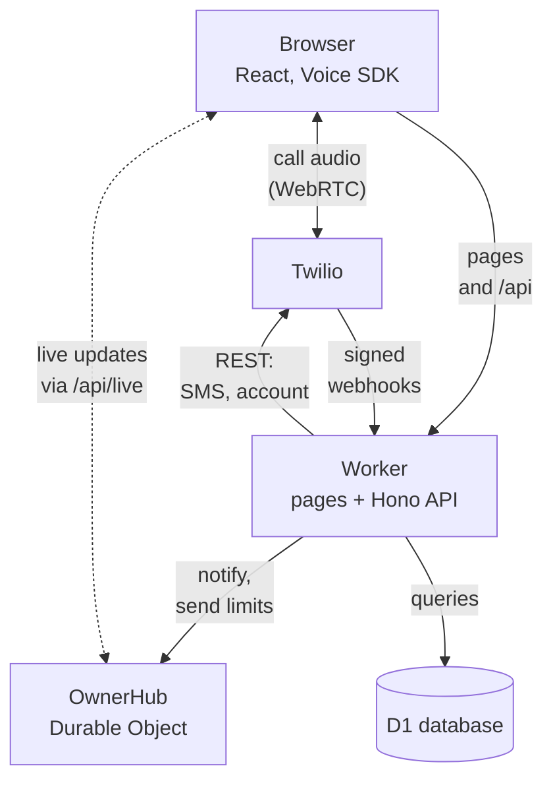
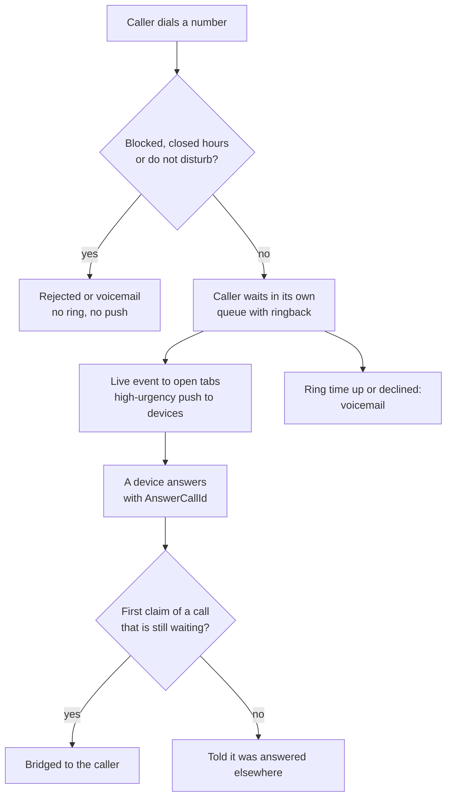

One Cloudflare Worker serves everything. TanStack Start renders the pages and Hono answers `/api/*`, both inside the same Worker.

## The parts

- **Browser.** A React app with TanStack Router and TanStack Query. The official `@twilio/voice-sdk` runs here and nowhere else. Call audio goes straight between the browser and Twilio and never passes through the Worker.
- **Worker.** Serves the server-rendered pages and the Hono API. Server-side loaders call the API in-process, so a page render costs no extra network hop. It also handles Twilio webhooks and runs the cron job every 15 minutes.
- **D1.** The database, reached through Drizzle ORM with versioned SQL migrations. Every table is scoped by `owner_id`. Provider SIDs for messages, calls and numbers carry unique constraints, which is what makes webhook handling idempotent.
- **OwnerHub.** One Durable Object per owner. It holds the WebSocket of every open tab for live updates, and keeps the hourly send counters for the spend guards.
- **Twilio.** Receives REST calls from the Worker, sends signed webhooks to it, and carries call audio to the browser.

## Stack

- TanStack Start (React, server-rendered) for the pages, with TanStack Router and TanStack Query in the browser.
- Hono for the API under `/api/*`.
- Cloudflare D1 with Drizzle ORM and versioned SQL migrations in `migrations/`.
- Better Auth for email and password sign-in.
- A Durable Object (`OwnerHub`) for live updates over WebSockets and for send limits.
- The official `@twilio/voice-sdk` in the browser.
- Tailwind CSS, i18next, Zod, libphonenumber-js, Biome and Vitest.

## How an incoming text reaches the screen

1. Twilio posts to `/api/twilio/sms/inbound`.
2. The Worker checks the signature, records the webhook under a unique key, and writes the message to D1.
3. After the write commits, the Worker tells the owner's hub. Events say only what changed.
4. Every open tab receives the event and refetches through TanStack Query.
5. If no tab is open, the Worker sends a Web Push notice instead.

A dropped socket loses nothing, because the browser refetches everything when it reconnects.

## How an incoming call reaches the owner

1. Twilio posts to `/api/twilio/voice/inbound`. A blocked caller gets `<Reject>`. Outside the number's hours, or with do not disturb on, the caller hears the voicemail greeting at once.
2. Otherwise the Worker stores the call with a random queue name and answers `<Enqueue>`. The queue's `waitUrl` (`/queue-wait`) plays ringback and decides when the caller leaves.
3. The Worker sends a live `incoming` event to every open tab and a high-urgency Web Push to every subscribed device. Tapping the notice opens `/answer/<call id>`.
4. Answering from the sheet or the notice places a call from the browser with `AnswerCallId`. The Worker checks it belongs to the owner, is still waiting and is not claimed, then answers `<Dial><Queue>`.
5. Just before the bridge, Twilio requests `/queue-bridge`, which marks the call answered and tells every other tab to stop ringing.
6. When the ring time is up or the owner declined, the caller leaves the queue and `/queue-done` answers with the voicemail greeting and `<Record>`. The recording goes to the voicemail pipeline.

Every call keeps one row, keyed by the caller's CallSid, with an outcome: answered, missed, voicemail, declined or blocked. Only missed calls count as missed and get the missed call notice.

## Decision records

The short records of the foundation choices are in [docs/decisions.md](https://github.com/bts-io/talvuno/blob/main/docs/decisions.md) in the repository. In brief:

| # | Decision | Why |
| --- | --- | --- |
| 1 | One Worker for pages and API | One build and one deploy. Splitting would add a second deploy and cross-origin cookies for no gain at this size. |
| 2 | Bun and Biome | One tool to install and run, one to lint and format. |
| 3 | D1 with Drizzle and versioned migrations | The Worker's own database with no connections to manage, and plain SQL migrations. |
| 4 | Better Auth with a single owner | Handles passwords, sessions and cookies. Sign-up is off and `/setup` claims the owner once. |
| 5 | A Durable Object per owner as the live hub | Live updates through hibernating WebSockets, and atomic counters without a transaction. |
| 6 | No Queues | Twilio retries failed webhooks and every webhook is recorded under a unique key. Statuses never move backwards. |
| 7 | The Voice SDK stays in the browser | It needs WebRTC. A unit test and a build stub keep it out of the Worker bundle. |
| 8 | Foreground calls only, said plainly | A web app cannot ring a locked phone. The app says so on setup, the keypad and settings. |
| 9 | English only, with right-to-left plumbing | Every string goes through i18next, and the layout uses start and end properties. |
| 10 | Phone numbers are E.164 everywhere | One normal form for comparing and storing, and an empty country list by default. |
| 11 | Every inbound call waits in a queue of its own | A closed app cannot be woken to ring. The caller waits with ringback, a push opens the app, and the first device to claim the call is bridged. |

A decision that changes one of these adds a new record instead of editing the old one.
